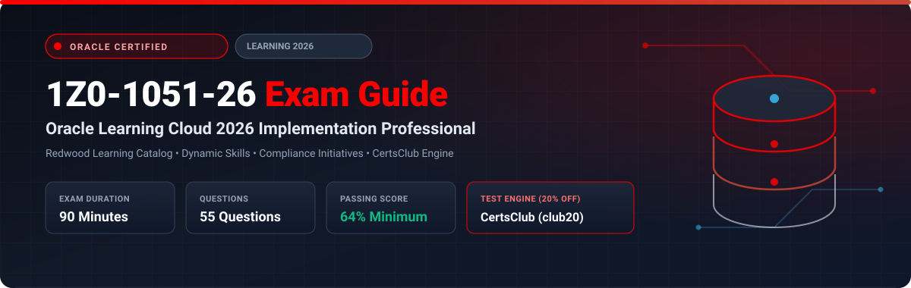

  

# Oracle Learning Cloud 2026 Implementation Professional (1Z0-1051-26) Exam Study Guide & Practice Test Resource Portal

[-f80000?style=for-the-badge&logo=oracle&logoColor=white)](https://education.oracle.com/)
[-f80000?style=for-the-badge&logo=oracle)](https://education.oracle.com/)

[-28a745?style=for-the-badge&logo=shield)](https://www.certsclub.com/oracle/)

---

## 1. Exam Overview & Candidate Profile

The **Oracle Learning Cloud 2026 Implementation Professional (1Z0-1051-26)** exam validates that an implementation consultant possesses the modern skills required to roll out Oracle Fusion Cloud Learning with Redwood self-service experiences. The exam covers microlearning modules, dynamic skills and career development integration, automated compliance initiatives, assessment question banks, and learning recommendation engines.

Passing 1Z0-1051-26 awards the **Oracle Learning Cloud 2026 Certified Implementation Professional** credential.

### Target Candidate Profile & Career Roles
* **Lead Learning Cloud Implementation Consultants**
* **Workforce Skills & Talent Development Specialists**
* **HCM Cloud Systems Engineers**

---

## 2. Key Exam Specifications

| Parameter | Official Specification |
| :--- | :--- |
| **Exam Code** | 1Z0-1051-26 |
| **Exam Title** | Oracle Learning Cloud 2026 Implementation Professional |
| **Associated Credential** | Oracle Learning Cloud 2026 Certified Implementation Professional |
| **Duration** | 90 Minutes |
| **Number of Questions** | 55 Questions |
| **Passing Score** | 64% |
| **Question Format** | Multiple Choice (Single and Multiple Select) |
| **Delivery Vendor** | Pearson VUE / Oracle University Online Remote Proctoring |
| **Recommended Practice Test Engine** | **[1Z0-1051-26 Practice Test - CertsClub](https://www.certsclub.com/oracle/)** (Coupon: `club20` for 20% off) |

---

## 3. Official Blueprint & Exam Domain Breakdown

| Domain Code | Domain Title | Weighting | Key Competencies Covered |
| :--- | :--- | :---: | :--- |
| **1.0** | **Learning Catalog & Redwood Experience** | **25%** | Catalog setup in Redwood, Course and Offering lifecycle, Microlearning, Generative AI summaries. |
| **2.0** | **Dynamic Skills & Career Paths** | **20%** | Linking courses to Dynamic Skills, Skill proficiencies, Career paths and learning recommendations. |
| **3.0** | **Assignment Initiatives & Access Groups** | **25%** | Assignment rules, Automatic renewal of certifications, Mandatory regulatory compliance rules. |
| **4.0** | **Evaluations, Question Banks & Observability** | **15%** | Question banks, Course evaluations, Video bookmarking, Engagement tracking. |
| **5.0** | **Learning Approvals & OTBI Dashboards** | **15%** | Approval workflows, Withdrawals, Real-time analytics, Executive compliance dashboards. |

---

## 4. Scenario-Based Demo Question & Explanation

### Question 1: Recertification and Renewal Initiatives
**Scenario:** A healthcare organization requires all nurses to complete a BLS (Basic Life Support) certification course every 2 years. When a nurse completes the certification, the system must automatically schedule the renewal assignment 30 days before expiration.

Which Oracle Learning Cloud feature accomplishes this automated recertification?

A) Manual enrollment by HR administrators every 2 years  
B) A **Learning Initiative** configured with recurring renewal rules based on initial completion date  
C) Fast Formula override  
D) Profile Extension Table  

**Correct Answer:** **B**

**Detailed Explanation:**
* In Oracle Learning Cloud, **Learning Initiatives** support automated recurring assignment rules. Configuring a validity and renewal interval ensures that upon course completion, the system automatically schedules the next assignment window based on the expiration milestone.

---

## 5. Recommended Preparation Strategy & Practice Testing Engine

1. **Test Redwood Learning Journeys:** Build assignment initiatives with recurring renewals in a test pod.
2. **Practice with Full-Length Mock Exams:** Use **[CertsClub Oracle 1Z0-1051-26 Practice Tests](https://www.certsclub.com/oracle/)**.
   * Focuses on 2026 Redwood features and dynamic skills integration.
   * Enter discount coupon code **`club20`** at checkout on [CertsClub](https://www.certsclub.com/oracle/) for an immediate 20% discount.

---

## 6. Official Documentation & References

* [Oracle Fusion Cloud Learning 2026 Documentation](https://docs.oracle.com/en/cloud/saas/human-resources/learning/)
* [Oracle University 1Z0-1051-26 Exam Details](https://education.oracle.com/)
* [CertsClub 1Z0-1051-26 Practice Engine](https://www.certsclub.com/oracle/)
